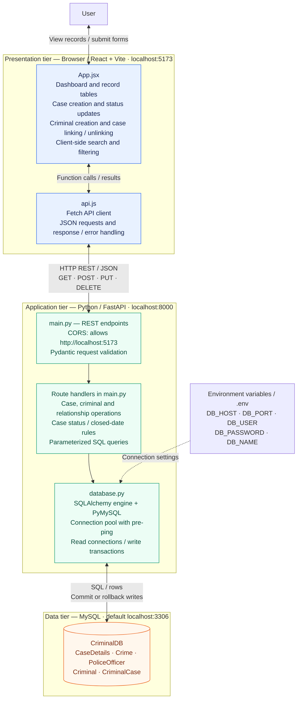

# Criminal Database Management System — System Architecture

This diagram describes the current implementation and local development configuration.

## API responsibilities

| Feature | Endpoints |
| --- | --- |
| Cases | `GET /cases`, `POST /cases`, `GET /cases/{case_id}`, `PUT /cases/{case_id}` |
| Criminal records | `GET /criminals`, `POST /criminals`, `GET /criminals/{criminal_id}/cases` |
| Case associations | `POST /criminal-cases`, `DELETE /criminal-cases/{criminal_id}/{case_id}` |
| Reference data | `GET /crimes`, `GET /officers` |
| Service checks | `GET /`, `GET /health`, `GET /db-test` |

## Request flow

1. The React application loads cases, criminals, crimes and officers through `api.js`. Search, status filters and dashboard counts run in the browser.
2. User form submissions send JSON to FastAPI, which validates request bodies with Pydantic and executes the corresponding route handler.
3. Handlers execute parameterized SQL through the SQLAlchemy engine and PyMySQL driver. Writes use `engine.begin()` transactions; reads use `engine.connect()`.
4. FastAPI returns JSON records, success messages or errors. React updates its state and refreshes records after successful changes.

## Implementation boundaries

- API routes, validation models and business rules currently reside together in `backend/app/main.py`; the diagram separates their responsibilities logically.
- Database configuration and the shared engine reside in `backend/app/database.py`. Queries use SQLAlchemy SQL expressions rather than ORM models; the declared `SessionLocal` is not used by the current handlers.
- The tables shown are referenced by backend SQL. Schema creation scripts are not present in this repository, so this is not a verified database schema diagram.
- The backend also exposes case-detail and criminal-case-history reads that currently have no wrappers in `frontend/src/api.js`.
- `/health` reports service health without querying MySQL; `/db-test` checks database connectivity.
- No authentication layer or production deployment configuration is implemented in the inspected source.

## Source files

- [React UI](../frontend/src/App.jsx)
- [HTTP client](../frontend/src/api.js)
- [FastAPI routes and validation](../backend/app/main.py)
- [Database connection](../backend/app/database.py)
- [Vite configuration](../frontend/vite.config.js)
